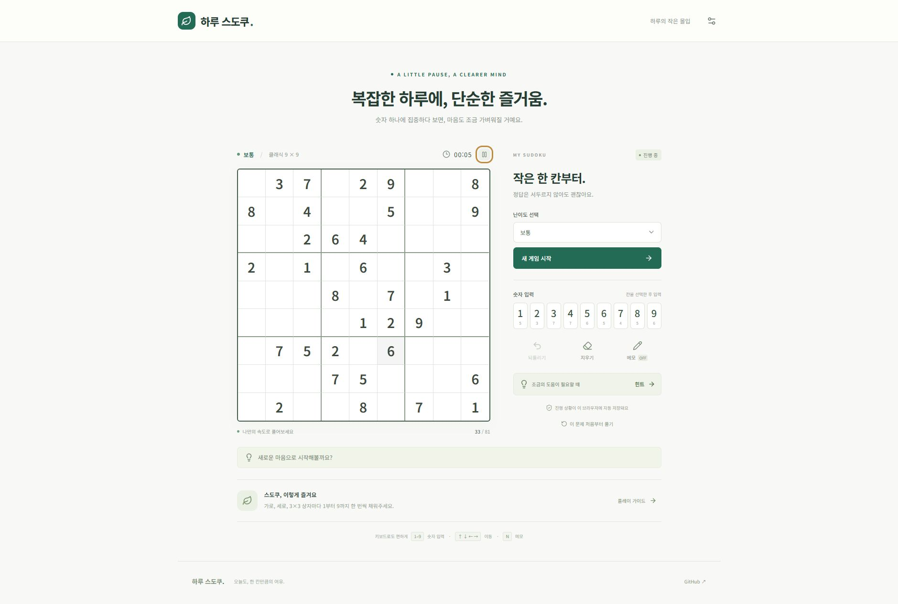

# 하루 스도쿠

하루의 작은 몰입. React + TypeScript로 만드는 한국어 스도쿠 웹게임.

**[지금 플레이하기](https://kjk0189-boop.github.io/haru-sudoku/)** · [배포 상태](https://github.com/kjk0189-boop/haru-sudoku/actions)

- [LLM 위키](docs/wiki/index.md)
- [기획](docs/wiki/product.md)
- [실행·배포](docs/wiki/deployment.md)
- [검증 기록](docs/wiki/verification.md)

`pnpm install` 후 `pnpm dev`로 실행한다. `pnpm test`, `pnpm build`로 검증한다.

진행 기록은 해당 브라우저에만 저장된다. 첫 버전의 난이도 분류는 잠정값이다.

